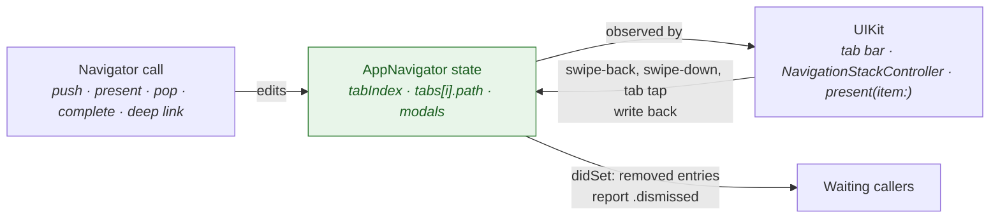
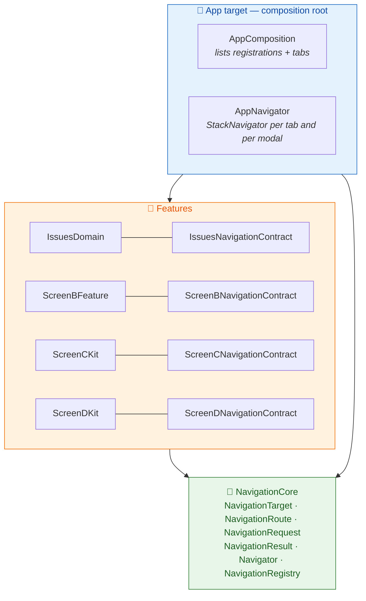

<div align="center">

# 🧭 SwiftNavigator

### State-driven, distributed navigation for a hybrid SwiftUI + TCA + UIKit app

[](https://swift.org)
[](https://developer.apple.com)
[](https://github.com/pointfreeco/swift-composable-architecture)
[](https://github.com/pointfreeco/swift-navigation)
[](#-the-four-tabs)

*Features import one shared module, `NavigationCore`, and never each other.*

</div>

---

## 🎯 What this POC proves

Navigation as state, routed by typed routes. A feature says *what* it wants—`IssuesNavigationContract.Route.pick`—a registry finds the module that owns it, and the screen appears because a navigation path changed. All of it running in a real hybrid app with **tabs, endless modals, TCA reducers, and plain UIKit screens**.

| ✅ | Capability |
|---|---|
| **State-driven navigation** | Each back stack is an observable `path: [NavigationEntry]`, modals are an observable array, and the selected tab is an index. Every `Navigator` call edits that state, and UIKit follows it (`NavigationStackController`, `present(item:)`); a swipe-back or swipe-down writes back to it. See [Navigation is state](#-navigation-is-state). |
| **Features never import each other** | Every feature imports `NavigationCore` (plus `NavigatorDependency` for TCA), its own contract, and the contracts of screens whose outputs it reads. Never another feature. |
| **Typed routes** | Each module's contract declares its own `Route` enum, and a request is `NavigationRequest(Route.pick)`. A module's capabilities are exactly its `Route` cases, so an unsupported request doesn't compile. Each module also owns its URL grammar, so a deep link is just another way to write a route. |
| **A target registry with module-owned registration** | `NavigationRegistry` maps each `NavigationTarget` to the one module that resolves it. Each feature declares `<X>.navigationRegistration`; the app shell only lists them. No screen switch anywhere. |
| **Results across modules** | `push`/`present(_:onResult:)` + `send(_:)`/`complete(with:)`. A handler gets any `.output` updates (typed by the sender's contract, e.g. `ScreenCNavigationContract.Output`), then exactly one final result—`.dismissed` included on swipe-back, swipe-down, or deep-link reset. |
| **Parent-owned child state** | A TCA parent can keep its child screen's state (`@Presents` + `.ifLet`) and still push it through the navigator. Leaving the screen, however it happens, clears that state. |
| **One pipeline** | Button taps, tab roots, inner screens, and deep links all become a `NavigationRequest` → registry → owning module. |
| **Tabs + endless modals** | Every tab and every modal is the same small `StackNavigator`; any screen can push or present any screen, forever. |
| **Fails loudly** | Duplicate registrations throw; a test checks every `NavigationTarget` is registered; memory tests check every screen is released when it leaves; `scripts/check-boundaries.sh` audits imports. |

---

## 🔁 Navigation is state

No screen asks UIKit to push or present another module's screen. A screen asks the `Navigator`, the navigator changes a value, and the UI catches up:



The whole navigation hierarchy is three properties:

| State | What it is | Bound to |
|-------|------------|----------|
| `AppNavigator.tabIndex` | The selected tab | `NavigatorTabBarController`, both ways |
| `StackNavigator.path` | One `[NavigationEntry]` per tab and per modal—each entry is a `NavigationRequest` plus an ID | `NavigationStackController(path:)` |
| `AppNavigator.modals` | The modals stacked on top, each with its own `StackNavigator` | `present(item:)` at level *n*, wired again on top of level *n + 1* |

Because the state is the source of truth:

- **Results can't leak.** Whatever removes an entry—`pop()`, swipe-back, `dismiss()`, swipe-down, a deep-link reset—goes through `path`'s or `modals`' `didSet`, which hands `.dismissed` to the caller still waiting. An `await navigator.presentForResult(...)` in a TCA effect always returns.
- **Deep links are state rewrites.** Landing a link means `modals = []`, `tabIndex = tab`, `path = []`, then appending the request.
- **Tests skip UIKit.** `AppNavigatorTests` drive the navigator and assert on `path`, `modals`, and results.
- **Restoration is within reach.** Every entry wraps a `Codable` `NavigationRequest`, so the stacks could be saved and rebuilt (not implemented yet).

### Two levels of state

The app shell owns the stacks; a TCA reducer can own a child's state. The Issues list keeps its detail as `@Presents var detail`, and one action does both halves together:

```swift
// IssuesList — set the child's state, then push its request
state.detail = IssuesDetail.State(issue: issue)
return .run { _ in await navigator.push(Issues.detailRequest(for: issue.wrappedValue)) }
```

When the push lands, the Issues registration builds the detail from the list's store, scoped to `detail`, through `NavigationContext.child(for:of:state:action:...)`. When the entry leaves—back, swipe-back, a deep-link reset—`child` sends `.detail(.dismiss)`, so the reducer's state never outlives the screen and needs no action of its own for it.

Screen C is the other way round: a UIKit screen the Issues list keeps no state for. It hears back through typed outputs (`pushForOutputs`), turned into actions.

---

## 🧩 The four tabs

Each tab's root is a plain request (`NavigationRequest(IssuesNavigationContract.Route.list)`) resolved through the registry—the app shell owns which tabs exist, features own the screens.

| Tab | Screen | Built with | Shows off |
|-----|--------|-----------|-----------|
| ❗ | **Issues** (+ **Issues detail**) | SwiftUI + TCA | Real domain with `@Shared` storage; doubles as the issue picker; detail state owned by the list; details host a **RefPicker** of related issues |
| 🅱️ | **Screen B** (+ in-module **B2**) | SwiftUI + TCA | Presents the Issues picker and receives the pick (`presentForResult`); pushes B2 through the navigator as `ScreenBNavigationContract.Route.b2` |
| 🅲 | **Screen C** (+ **C2**) | Plain UIKit | Compose mode: Send reports text back to the Issues list's *Context* chip and stays up; also picks an issue, then opens it |
| 🅳 | **Screen D** (+ **D2**) | Plain UIKit | `complete(with: .dismissed)` closes it, pushed or presented |

---

## ❗ The Issues feature

The Issues tab is the one tab that carries a real domain, so the POC shows its seams under
something with actual state rather than four buttons.

| Piece | What it does |
|-------|--------------|
| `Issue` | A plain `struct`—`Codable`, `Equatable`, `Sendable`. One model for both screens. |
| `@Shared(.issues)` | `IdentifiedArrayOf<Issue>` persisted to `Documents/issues.json`. The seed data is the key's *default*, so first launch has content with no seeding code. |
| `IssuesList` | The list, plus a strip of explicit cross-module chips. Creating and deleting write straight to the shared array. Doubles as the **issue picker** other modules open with `Route.pick`. |
| `IssuesDetail` | From the list: the list's child—its state in `IssuesList.State.detail`, its screen pushed through the navigator as `Route.listDetails(id:)` (see [Two levels of state](#two-levels-of-state)). From another module: `Route.open(id:)` builds a standalone detail on the same `@Shared` array, so edits still write through. **Random issue** pushes `Route.random`, a standalone detail of a random stored issue. |

The part worth reading the code for is how detail edits get home:

```swift
// IssuesList — deriving a Shared that points *into* the persisted array
guard let issue = Shared(state.$issues[id: id]) else { return .none }
state.detail = IssuesDetail.State(issue: issue)
```

```swift
// IssuesDetail — editing it writes to the list and to disk at once
case let .titleChanged(title):
    state.$issue.withLock { $0.title = title }
    return .none
```

There is no save action, no delegate carrying the edited issue back, and no cancel. The detail
screen does not "return" anything, because it was never holding a copy.

The UI follows Autodesk Construction Cloud's issues-list and issue-details specs: row geometry,
the `#928  -  Commissioning` title format, status pin colors, and the collapsible
"More Issue Details (N Empty)" section. What those specs assume and this POC has no backend for—AI
suggestion pins, attachments, references, permissions, and server-configured field ordering—is
left out; field order is a fixed array here.

---

## 🏗 Architecture at a glance



| Layer | Owns | Imports |
|-------|------|---------|
| **NavigationCore** 🍃 | The shared vocabulary: targets, the `NavigationRoute` protocol, requests, results, `Navigator`, `NavigationContext`, registry | Nothing in this package |
| **NavigatorDependency** | `@Dependency(\.navigator)` and `NavigationContext.child`, for TCA features | `NavigationCore` |
| **`<X>NavigationContract`** | That module's `target`, its own `Route` enum, and the `Output` values it sends back | `NavigationCore`—imported by module X and by any feature that calls it |
| **RefPicker** | Shared component: a reference list with **Add Reference**—needs nothing from its host; it lists the modules it can pick from (one per contract it imports), asks which when there are several (`pushForResult`), and each picked `EntityRef` carries the request that opens it, built by its owning module, so hosts implement no routes | `NavigationCore`, `NavigatorDependency`, the contracts it picks from |
| **Feature** 🧱 | Screens, `route(for:)`, `<X>.navigationRegistration` | `NavigationCore`, `NavigatorDependency` (TCA), `RefPicker`, its own contract, any other module's contract |
| **App target** 📱 | Which modules and tabs exist, `AppNavigator`, URL handling | Everything (and that's its only job) |

**Adding a screen** to a feature touches only that feature. **Adding a module** adds one `NavigationTarget` case in the core and one line in `AppComposition.registrations`—and the composition test fails until the second is done.

---

## 📦 The vocabulary

```swift
public enum NavigationTarget: String, CaseIterable { case issues, screenB, screenC, screenD }

public protocol NavigationRoute: Hashable, Sendable { static var target: NavigationTarget { get } }

public struct NavigationRequest: Hashable {          // one module's Route, boxed
    public init<Route: NavigationRoute>(_ route: Route)
    public func route<Route: NavigationRoute>(as: Route.Type = Route.self) -> Route?
}

// IssuesNavigationContract — the module's capabilities are exactly these cases
public enum Route: NavigationRoute {
    case list, pick, random, screenCContext
    case open(id: String), listDetails(id: String)
    public static let target: NavigationTarget = .issues
}

public enum NavigationResult { case selectedEntity(EntityRef), output(NavigationOutput), dismissed }

@MainActor
public protocol Navigator: Sendable {
    func push(_ request: NavigationRequest, onResult: NavigationResultHandler?)
    func present(_ request: NavigationRequest, onResult: NavigationResultHandler?)
    func send(_ result: NavigationResult)          // update the caller, stay on screen
    func complete(with result: NavigationResult)   // final result, leave
    func pop()
    func popToRoot()
    func dismiss()
    func incomingRequests(for target: NavigationTarget) -> AsyncStream<NavigationRequest>   // deep links for a root screen
}
// + push(_:)/present(_:) without a handler; for TCA effects: `pushForResult(_:)`/`presentForResult(_:)` (final result),
//   `pushForResults(_:)`/`presentForResults(_:)` (every result), and `pushForOutputs(_:as:)`/`presentForOutputs(_:as:)` (typed outputs)
```

Every module declares its `Route` in its own contract—Issues: `list, pick, open(id:), random, listDetails(id:), screenCContext`; Screen B: `home, b2`; Screen C: `home, compose(prompt:)`; Screen D: `home`. Any feature may import any module's contract to call it, never another feature. A module also routes to itself with its own routes (`listDetails`, `b2`), so its inner screens live in the same navigation state as everything else.

The caller decides how a screen appears—`push` or `present`—and the target module never needs to change for a new caller. TCA features get the navigator as `@Dependency(\.navigator)`; UIKit screens get it in their initializer.

---

## 🔄 Calling another module

```swift
// ScreenBFeature (TCA) — open the Issues picker and wait for the pick
case .linkIssueTapped:
    return .run { send in
        let result = await navigator.presentForResult(NavigationRequest(IssuesNavigationContract.Route.pick))
        if case let .selectedEntity(issue) = result { await send(.issueLinked(issue)) }
    }

// IssuesList (TCA), picker mode — report the tapped issue
return .run { _ in await navigator.complete(with: .selectedEntity(picked)) }

// ScreenCViewController (UIKit) — same flow with a handler
navigator.present(NavigationRequest(IssuesNavigationContract.Route.pick)) { result in
    guard case let .selectedEntity(issue) = result else { return }
    navigator.push(NavigationRequest(IssuesNavigationContract.Route.open(id: issue.id)))
}
```

Screen B, Screen C, and Issues share nothing but `NavigationCore` and each other's contracts.

---

## 🧱 How the app navigator works

Every tab and every modal is the same tiny type—an observable path plus the result handlers of its entries:

```swift
@Observable final class StackNavigator {
    var path: [NavigationEntry] = [] {
        didSet {   // pop, swipe-back, reset: whatever disappeared reports .dismissed
            let removedIDs = Set(oldValue.map(\.id)).subtracting(path.map(\.id))
            for id in removedIDs {
                leaveActions.removeValue(forKey: id)?()
                handlers.removeValue(forKey: id)?(.dismissed)
            }
        }
    }
    private var handlers: [UUID: NavigationResultHandler] = [:]
    private var leaveActions: [UUID: @MainActor () -> Void] = [:]   // NavigationContext.onLeave
    ...
}
```

`AppNavigator` holds `tabs: [StackNavigator]` and `modals: [ModalNavigator]` (each modal = root entry + its own `StackNavigator`), and sends every call to the **current** stack: the top modal's, else the selected tab's. Dismissing a modal—by `dismiss()`, swipe-down, or a deep link—reports `.dismissed` for it and everything pushed inside it, so a waiting caller is never left hanging.

`AppComposition` binds each stack to a `NavigationStackController` and wires modal level *n + 1* on top of level *n*, however deep presents go. Each entry is resolved with a `NavigationContext`: the navigator, the screen it was pushed from (`parent`), and an `onLeave` hook.

---

## 🔗 Deep links

`NavigationRegistry.request(for:)` turns a URL into a `NavigationRequest`: it checks the scheme and target, then hands a `DeepLink` (target, path, query) to that module's registration, whose `deepLink` closure maps it to one of its own `Route`s. Each module owns its URL grammar; Issues':

```text
demoapp://issues                    → .list
demoapp://issues/<id>              → .open(id:)         e.g. demoapp://issues/00000000-0000-0000-0000-000000000002
demoapp://issues?action=screenCContext → .screenCContext
```

One fixed landing rule: dismiss modals → switch to the tab whose root is that module (if any) and reset it → push the request (unless that tab's root already is the request). Invalid links are ignored.

Some routes go to the root screen instead of being pushed: whatever a registration's `toRoot` accepts. The root screen gets them through `Navigator.incomingRequests(for:)`:

- **Issues** sends `.open` to its list, so a linked issue opens as the list's own child, exactly as a tap would.
- `.screenCContext` runs the same code as the **Push Screen C with context** chip, so Send fills the Issues header just like the in-app flow.

A link that arrives before the root subscribes (cold launch) is held until it does.

```bash
scripts/deeplink.sh screenC                                         # → Screen C tab
xcrun simctl openurl booted "demoapp://issues?action=screenCContext" # → Issues tab, Screen C with context
scripts/deeplink.sh issues 00000000-0000-0000-0000-000000000002     # → issue #931
# same as: xcrun simctl openurl booted "demoapp://screenC"
```

> ⚠️ `demoapp://` is a generic scheme. If another app on the simulator registers it too, iOS may route links to that app.

---

## 🗂 Project layout

```text
SwiftNavigator
├── TheNavigation/                       # 📱 App target—composition root
│   ├── SceneDelegate.swift              #    deep links (cold + warm)
│   └── Composition/
│       ├── AppComposition.swift         #    registrations, tabs, UIKit stack + modal wiring
│       ├── AppNavigator.swift           #    StackNavigator, ModalNavigator, AppNavigator
│       └── NavigatorTabBarController.swift
├── MyLibrary/                           # 📦 Local SPM package
│   ├── Sources/
│   │   ├── NavigationCore/              # 🍃 the shared vocabulary
│   │   ├── NavigatorDependency/         #    @Dependency(\.navigator), NavigationContext.child
│   │   ├── <X>NavigationContract/       #    each module's target, Route, and Output (×4)
│   │   ├── RefPicker/                   #    shared reference list + Add Reference
│   │   ├── IssuesDomain/                # ❗ SwiftUI + TCA, @Shared storage
│   │   ├── ScreenBFeature/              # 🅱️ SwiftUI + TCA
│   │   ├── ScreenCKit/                  # 🅲 plain UIKit
│   │   └── ScreenDKit/                  # 🅳 plain UIKit
│   └── Tests/
│       ├── NavigationCoreTests/         #    requests, registry, deep-link parser
│       ├── RefPickerTests/              #    open, add, dismiss, no duplicates
│       ├── FeatureNavigationTests/      #    each module's routes, Screen B and B2
│       └── IssuesDomainTests/           #    TestStore coverage: list, picker, detail navigation
├── TheNavigationTests/                  #    AppNavigator, deep links, composition, memory
├── TheNavigationUITests/                #    end-to-end flows in the running app
├── scripts/check-boundaries.sh          #    module import audit
├── scripts/deeplink.sh                  #    open a deep link in the simulator
└── docs/
    ├── NavigationInOneFile.swift        # 📝 the whole architecture in one runnable file
    ├── navigation-contracts-plan.md     # 📝 design decisions
    └── cross-module-delegate.md         # 📝 history of the data-passing question
```

---

## 🚀 Getting started

```bash
git clone https://github.com/guycohenadsk/SwiftNavigator.git
cd SwiftNavigator
open TheNavigation.xcodeproj
```

Build and run (iOS 17+). Then try:

1. **Context round-trip**—Issues → **Push Screen C with context**: type, **Send** (Screen C stays), go back—the chip reads *Screen C said “…”*.
2. **Result across modules**—Screen B → **Link an issue**: pick one, it comes back. Swipe the picker away instead: nothing is linked.
3. **Same from UIKit**—Screen C → **Pick an issue, then open it**.
4. **Reference picker**—open an issue → **Add Reference** under *Related issues* → pick one; tap it to open it.
5. **Endless presents**—present Screen D from an issue → present Screen B from D → keep going; **Close** on D closes just D.
6. **Deep link**—from the Screen D tab, open `demoapp://issues/00000000-0000-0000-0000-000000000002`: the Issues tab opens that issue from its list.
7. **Shared persistence**—open an issue, retype its title, swipe back: the row has already changed, and survives a relaunch.
8. **Random issue**—Issues → **Random issue** opens a standalone detail of a random stored issue.

Or read the idea without the app:

```bash
swift docs/NavigationInOneFile.swift
```

Run the tests:

```bash
cd MyLibrary && xcodebuild test -scheme MyLibrary-Package \
  -destination 'platform=iOS Simulator,name=iPhone 17 Pro' -skipMacroValidation

xcodebuild test -project TheNavigation.xcodeproj -scheme TheNavigation \
  -destination 'platform=iOS Simulator,name=iPhone 17' -skipMacroValidation

./scripts/check-boundaries.sh
```

(`swift test` can't run them—the package is iOS-only.)

---

## 📚 Built with

- [swift-composable-architecture](https://github.com/pointfreeco/swift-composable-architecture)—reducers for Issues and Screen B
- [swift-navigation](https://github.com/pointfreeco/swift-navigation) (`UIKitNavigation`)—`NavigationStackController`, `UIBindable`, state-driven presentation for UIKit

<div align="center">

*A proof of concept: navigation as state, screens as strangers, routes as the only shared language.*

</div>
