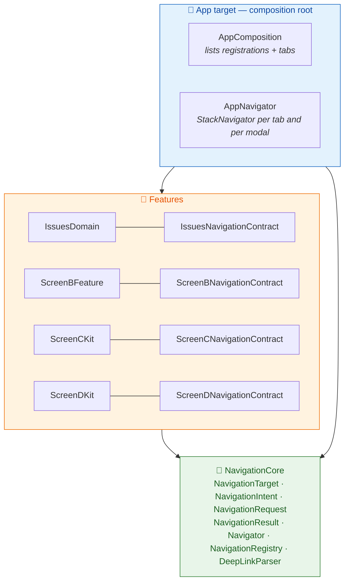

<div align="center">

# 🧭 SwiftNavigator

### Distributed navigation contracts for a hybrid SwiftUI + TCA + UIKit app

[](https://swift.org)
[](https://developer.apple.com)
[](https://github.com/pointfreeco/swift-composable-architecture)
[](https://github.com/pointfreeco/swift-navigation)
[](#-the-four-tabs)

*Features import one shared module, `NavigationCore`, and never each other.*

</div>

---

## 🎯 What this POC proves

[dekelmaman/navigation_contract](https://github.com/dekelmaman/navigation_contract)'s architecture — semantic intents, a target registry, module-owned registrations — applied to a real hybrid app with **tabs, endless modals, TCA reducers, and plain UIKit screens**.

| ✅ | Capability |
|---|---|
| **Features never import each other** | Every feature imports `NavigationCore` (plus `NavigatorDependency` for TCA), its own contract, and the contracts of screens whose outputs it reads. Never another feature. |
| **Semantic intents** | A request is `.open(EntityRef)`, `.browse(target)`, `.selectSingle(target)`, or `.compose(target, prompt:)` — the same four for every module. |
| **Module-owned registration** | Each feature declares `<X>.navigationRegistration`; the app shell only lists them. No screen switch anywhere. |
| **Results across modules** | `push`/`present(_:onResult:)` + `send(_:)` / `complete(with:)`. A handler gets any `.output` updates (typed by the sender's contract, e.g. `ScreenCNavigationContract.Output`), then exactly one final result — `.dismissed` included on swipe-back, swipe-down, or deep-link reset. |
| **One pipeline** | Button taps, tab roots, and deep links all become a `NavigationRequest` → registry → owning module. |
| **Tabs + endless modals** | Every tab and every modal is the same small `StackNavigator`; any screen can push or present any screen, forever. |
| **Fails loudly** | Duplicate registrations throw; a test checks every `NavigationTarget` is registered; `scripts/check-boundaries.sh` audits imports. |

---

## 🧩 The four tabs

Each tab's root is a plain request (`.browse(.issues)`) resolved through the registry — the app shell owns which tabs exist, features own the screens.

| Tab | Screen | Built with | Shows off |
|-----|--------|-----------|-----------|
| ❗ | **Issues** (+ in-module **Issues Detail**) | SwiftUI + TCA | Real domain with `@Shared` storage; doubles as the issue picker; details host a **RefPicker** of related issues |
| 🅱️ | **Screen B** (+ in-module **B2**) | SwiftUI + TCA | Presents the Issues picker and receives the pick (`presentForResult`) |
| 🅲 | **Screen C** (+ **C2**) | Plain UIKit | Compose mode: Send reports text back to the Issues list's *Context* chip and stays up; also picks an issue, then opens it |
| 🅳 | **Screen D** (+ **D2**) | Plain UIKit | `complete(with: .dismissed)` closes it, pushed or presented |

---

## ❗ The Issues feature

The Issues tab is the one tab that carries a real domain, so the POC shows its seams under
something with actual state rather than four buttons.

| Piece | What it does |
|-------|--------------|
| `Issue` | A plain `struct` — `Codable`, `Equatable`, `Sendable`. One model for both screens. |
| `@Shared(.issues)` | `IdentifiedArrayOf<Issue>` persisted to `Documents/issues.json`. The seed data is the key's *default*, so first launch has content with no seeding code. |
| `IssuesList` | The list, plus a strip of explicit cross-module chips. Creating and deleting write straight to the shared array. Doubles as the **issue picker** other modules open with `.selectSingle(.issues)`. |
| `IssuesDetail` | From the list: pushed in-module via `@Presents`, never touching the registry. From anywhere else (another module, a deep link): `.open(EntityRef(target: .issues, id:))` — the registration looks the issue up in the same `@Shared` array, so edits still write through. |

The part worth reading the code for is how detail edits get home:

```swift
// IssuesList — deriving a Shared that points *into* the persisted array
guard let issue = Shared(state.$issues[id: id]) else { return .none }
state.detail = IssuesDetail.State(issue: issue)
```

```swift
// IssuesDetail — editing it writes to the list and to disk at once
case let .titleChanged(title):
    state.$issue.withLock { $0.title = title }
    return .none
```

There is no save action, no delegate carrying the edited issue back, and no cancel. The detail
screen does not "return" anything, because it was never holding a copy.

The UI follows Autodesk Construction Cloud's issues-list and issue-details specs: row geometry,
the `#928  -  Commissioning` title format, status pin colors, and the collapsible
"More Issue Details (N Empty)" section. What those specs assume and this POC has no backend for —
AI suggestion pins, attachments, references, permissions, and server-configured field ordering —
is left out; field order is a fixed array here.

---

## 🏗 Architecture at a glance



| Layer | Owns | Imports |
|-------|------|---------|
| **NavigationCore** 🍃 | The shared vocabulary: targets, intents, requests, results, `Navigator`, registry, deep-link parser | Nothing in this package |
| **`<X>NavigationContract`** | That module's `target`, its own `Route` enum, and the `Output` values it sends back | `NavigationCore` — imported by module X, and by callers that read X's outputs |
| **RefPicker** | Shared component: a reference list with **Add Reference** — opens with `.open`, adds by pushing `.selectSingle` (`pushForResult`) | `NavigationCore`, `NavigatorDependency` |
| **Feature** 🧱 | Screens, `route(for:)`, `<X>.navigationRegistration` | `NavigationCore`, `NavigatorDependency` (TCA), `RefPicker`, its own contract, contracts whose outputs it reads |
| **App target** 📱 | Which modules and tabs exist, `AppNavigator`, URL handling | Everything (and that's its only job) |

**Adding a screen** to a feature touches only that feature. **Adding a module** adds one `NavigationTarget` case in the core and one line in `AppComposition.registrations` — and the composition test fails until the second is done.

---

## 📦 The vocabulary

```swift
public enum NavigationTarget: String, CaseIterable { case issues, screenB, screenC, screenD }

public enum NavigationIntent: Hashable, Codable {
    case open(EntityRef)                  // show one entity
    case browse(NavigationTarget)         // show the module's main screen
    case selectSingle(NavigationTarget)   // pick one entity and report it back
    case compose(NavigationTarget, prompt: String)   // ask for text; replies come as typed .output
}

public enum NavigationResult { case selectedEntity(EntityRef), message(String), dismissed }

@MainActor
public protocol Navigator: Sendable {
    func push(_ request: NavigationRequest, onResult: NavigationResultHandler?)
    func present(_ request: NavigationRequest, onResult: NavigationResultHandler?)
    func send(_ result: NavigationResult)          // update the caller, stay on screen
    func complete(with result: NavigationResult)   // final result, leave
    func pop()
    func popToRoot()
    func dismiss()
}
// + push(_:) / present(_:) without a handler; for TCA effects: `pushForResult(_:)` / `presentForResult(_:)` (final result)
//   and `pushForResults(_:)` / `presentForResults(_:)` (AsyncStream of every result)
```

The caller decides how a screen appears — `push` or `present` — and the target module never needs to change for a new caller. TCA features get the navigator as `@Dependency(\.navigator)`; UIKit screens get it in their initializer.

---

## 🔄 Calling another module

```swift
// ScreenBFeature (TCA) — open the Issues picker and wait for the pick
case .linkIssueTapped:
    return .run { send in
        let result = await navigator.presentForResult(NavigationRequest(intent: .selectSingle(.issues)))
        if case let .selectedEntity(issue) = result { await send(.issueLinked(issue)) }
    }

// IssuesList (TCA), picker mode — report the tapped issue
return .run { _ in await navigator.complete(with: .selectedEntity(picked)) }

// ScreenCViewController (UIKit) — same flow with a handler
navigator.present(NavigationRequest(intent: .selectSingle(.issues))) { result in
    guard case let .selectedEntity(issue) = result else { return }
    navigator.push(NavigationRequest(intent: .open(issue)))
}
```

Screen B, Screen C, and Issues share nothing but `NavigationCore`.

---

## 🧱 How the app navigator works

Every tab and every modal is the same tiny type — the shape of navigation_contract's navigator:

```swift
@Observable final class StackNavigator {
    var path: [NavigationEntry] = [] {
        didSet {   // pop, swipe-back, reset: whatever disappeared reports .dismissed
            let removedIDs = Set(oldValue.map(\.id)).subtracting(path.map(\.id))
            for id in removedIDs { handlers.removeValue(forKey: id)?(.dismissed) }
        }
    }
    private var handlers: [UUID: NavigationResultHandler] = [:]
    ...
}
```

`AppNavigator` holds `tabs: [StackNavigator]` and `modals: [ModalNavigator]` (each modal = root entry + its own `StackNavigator`), and sends every call to the **current** stack: the top modal's, else the selected tab's. Dismissing a modal — by `dismiss()`, swipe-down, or a deep link — reports `.dismissed` for it and everything pushed inside it, so a waiting caller is never left hanging.

`AppComposition` binds each stack to a `NavigationStackController` and wires modal level *n + 1* on top of level *n*, however deep presents go.

---

## 🔗 Deep links

Same format and parser as navigation_contract:

```text
demoapp://<target>                 → .browse(target)              e.g. demoapp://screenB
demoapp://<target>/<id>            → .open(EntityRef(target, id)) e.g. demoapp://issues/00000000-0000-0000-0000-000000000002
demoapp://<target>?action=<name>   → .perform(target, action:)    e.g. demoapp://issues?action=screenCContext
```

`.perform` hands the action name to the module's screen at the root of the tab it lands on, through
`Navigator.performedActions(for:)`. The Issues list subscribes when it first appears and turns
`screenCContext` into a `.deepLinkAction`, which runs the same code as the **Push Screen C with
context** chip, so Send fills the Issues header just like the in-app flow. A link that arrives before
the list subscribes (cold launch) is held until it does.

One fixed landing rule: dismiss modals → switch to the tab whose root is that module (if any) and reset it → push the request (unless that tab's root already is the request). Invalid links are ignored.

```bash
scripts/deeplink.sh screenC                                         # → Screen C tab
xcrun simctl openurl booted "demoapp://issues?action=screenCContext" # → Issues tab, Screen C with context
scripts/deeplink.sh issues 00000000-0000-0000-0000-000000000002     # → issue #931
# same as: xcrun simctl openurl booted "demoapp://screenC"
```

> ⚠️ navigation_contract's demo app also registers `demoapp://`. On a simulator with both installed, iOS may route links to the other app.

---

## 🗂 Project layout

```text
SwiftNavigator
├── TheNavigation/                       # 📱 App target — composition root
│   ├── SceneDelegate.swift              #    deep links (cold + warm)
│   └── Composition/
│       ├── AppComposition.swift         #    registrations, tabs, UIKit stack + modal wiring
│       ├── AppNavigator.swift           #    StackNavigator, ModalNavigator, AppNavigator
│       └── NavigatorTabBarController.swift
├── MyLibrary/                           # 📦 Local SPM package
│   ├── Sources/
│   │   ├── NavigationCore/              # 🍃 the shared vocabulary
│   │   ├── NavigatorDependency/         #    @Dependency(\.navigator) + Unimplemented
│   │   ├── <X>NavigationContract/       #    each module's target + Route (×4)
│   │   ├── RefPicker/                   #    shared reference list + Add Reference
│   │   ├── IssuesDomain/                # ❗ SwiftUI + TCA, @Shared storage
│   │   ├── ScreenBFeature/              # 🅱️ SwiftUI + TCA
│   │   ├── ScreenCKit/                  # 🅲 plain UIKit
│   │   └── ScreenDKit/                  # 🅳 plain UIKit
│   └── Tests/
│       ├── NavigationCoreTests/         #    requests, registry, deep-link parser
│       ├── RefPickerTests/              #    open, add, dismiss, no duplicates
│       ├── FeatureNavigationTests/      #    each module's routes
│       └── IssuesDomainTests/           #    TestStore coverage, including the picker
├── TheNavigationTests/                  #    AppNavigator, deep links, composition
├── TheNavigationUITests/                #    end-to-end flows in the running app
├── scripts/check-boundaries.sh          #    module import audit
├── scripts/deeplink.sh                 #    open a deep link in the simulator
└── docs/
    ├── navigation-contracts-plan.md     # 📝 design decisions
    └── cross-module-delegate.md         # 📝 history of the data-passing question
```

---

## 🚀 Getting started

```bash
git clone https://github.com/guycohenadsk/SwiftNavigator.git
cd SwiftNavigator
open TheNavigation.xcodeproj
```

Build & run (iOS 17+). Then try:

1. **Context round-trip** — Issues → **Push Screen C with context**: type, **Send** (Screen C stays), go back — the chip reads *Screen C said “…”*.
2. **Result across modules** — Screen B → **Link an issue**: pick one, it comes back. Swipe the picker away instead: nothing is linked.
3. **Same from UIKit** — Screen C → **Pick an issue, then open it**.
4. **Reference picker** — open an issue → **Add Reference** under *Related issues* → pick one; tap it to open it.
5. **Endless presents** — present Screen D from an issue → present Screen B from D → keep going; **Close** on D closes just D.
6. **Deep link** — from the Screen D tab, open `demoapp://issues/00000000-0000-0000-0000-000000000002`.
7. **Shared persistence** — open an issue, retype its title, swipe back: the row has already changed, and survives a relaunch.

Run the tests:

```bash
cd MyLibrary && xcodebuild test -scheme MyLibrary-Package \
  -destination 'platform=iOS Simulator,name=iPhone 17 Pro' -skipMacroValidation

xcodebuild test -project TheNavigation.xcodeproj -scheme TheNavigation \
  -destination 'platform=iOS Simulator,name=iPhone 17' -skipMacroValidation

./scripts/check-boundaries.sh
```

(`swift test` can't run them — the package is iOS-only.)

---

## 📚 Built with

- [dekelmaman/navigation_contract](https://github.com/dekelmaman/navigation_contract) — the navigation architecture
- [swift-composable-architecture](https://github.com/pointfreeco/swift-composable-architecture) — reducers for Issues and Screen B
- [swift-navigation](https://github.com/pointfreeco/swift-navigation) (`UIKitNavigation`) — `NavigationStackController`, `UIBindable`, state-driven presentation for UIKit

<div align="center">

*A proof of concept: navigation as state, screens as strangers, intents as the only shared language.*

</div>
